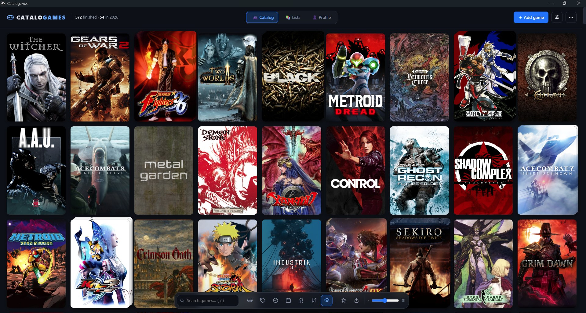
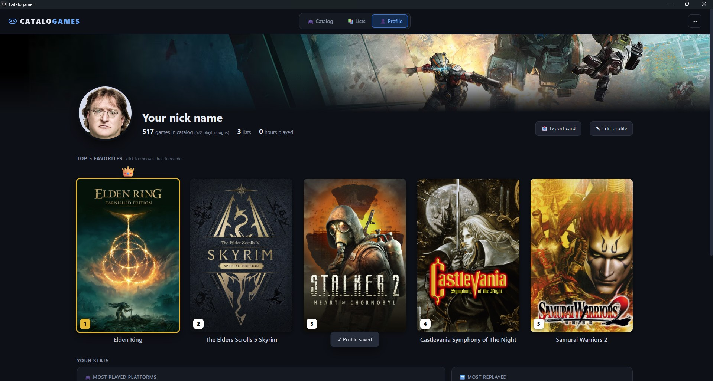
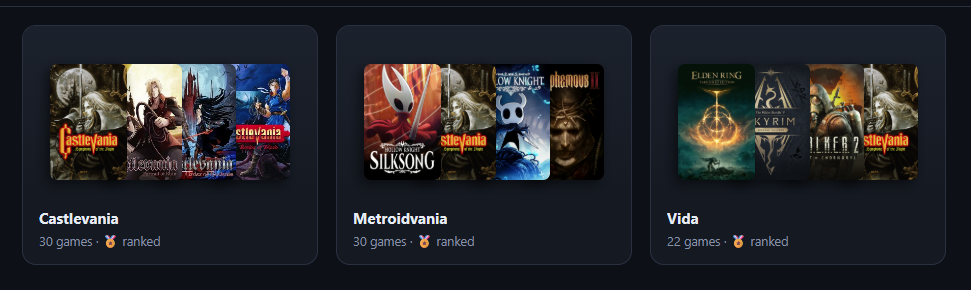

# 🎮 Catalogames

**🇺🇸 English** | [🇧🇷 Português](README.pt-BR.md)

*A game catalog that works as a local backlog.*

> [!NOTE]
> **Hi! A heads-up before anything else: this project is vibe-coded.** 🤖
> All the code was written with AI (Claude, by Anthropic), based on the ideas, requests and testing of **[@leoblaidd](https://github.com/leoblaidd)**.
> I know a lot of people don't like AI-made work, and that's okay. That's why this notice comes first, so you can decide calmly whether you want to keep going. If you do, welcome! 🎮

**Author:** [@leoblaidd](https://github.com/leoblaidd)

Catalogames is a lightweight Windows app (a ~1.4 MB installer, built with Tauri) that organizes the games you've beaten, played or want to play. It works like a shelf of covers: you add each game with a score, platform and year, and build lists and rankings with them. Everything is saved in a folder on your PC, with no account, no cloud and no internet required.

> The app is available in **English**, **Portuguese** and **Spanish**, and opens in your Windows language. The names in bold below are the labels you'll see in the English version.



---

## ✨ Features

The app has three tabs at the top center: **🎮 Catalog**, **📚 Lists** and **👤 Profile**, with a sliding animation between them. The name sits on the left with the tab's numbers next to it, and the tab's buttons are on the right, with the settings always in the corner.

### Catalog
- A grid of covers with adjustable size, grouped by the year you finished the game, by release year, or not grouped.
- For each game: title, platform, status (**Finished** / Finished, **Played** / Played or **Want to play** / Want to play), year finished, release year, hours played, score from 0 to 10 (in half points), genres, favorite, and a comment or review.
- Instant search (<kbd>/</kbd> shortcut) and filters by platform, genre, status, year and score.
- **Exact score filter:** "Score 5" shows games rated 5 and 5.5, with the 5.5 ones first.
- Sort by date, score, name, hours or release.
- **Two ways to show the filters** (choose in Settings):
  - **Top bar**, with the filters written out.
  - **Floating dock** at the bottom, with search, an icon for each filter and the cover size. Each icon opens a drawer with the options as small tiles.
- A button to hide the search and filters (or the dock) and leave only the covers.
- **Played it again?** Games with the same title count as the same game played in different years:
  - When adding a game, the app suggests it and pulls in the score, release year, genres and cover. You only adjust the year.
  - Score, release year, genres and cover always stay the same across all playthroughs.
  - The game screen only shows "🔁 You played this X times" and the years. Clicking a year opens that playthrough.
  - If the playthroughs end up with different data, a **Match the 1st entry** button appears, copying everything from the first playthrough you added.
  - Outside of grouping by year finished, playthroughs become a stack of covers. Hover over them and they fan out to the side.
- Genres in alphabetical order, with search: type to filter or create a new one. The list can be edited in Settings.
- **Import a list of games** from a `.txt` or `.md` file, one per line: `Name - year played - game year - platform - score`. Anything that doesn't follow the pattern is skipped, and the app shows a preview before importing. Imported games get a colored border until you fill in the cover, hours and genres.

- **Game screen:** click a cover and a centered card opens, with the game's banner at the top and the large cover overlapping it. Without a banner, the app uses the cover itself, blurred. After editing, you come back to this screen.
- **Art mode:** the button next to the X opens the game screen in full screen, with the banner filling everything, a bigger cover in the lower-left corner, the info beside it and the buttons on the right. **Back** (or Esc) returns to normal mode.

### Profile



- Profile picture, name and a wide header image that expands when you scroll up.
- Numbers: games cataloged, lists and hours played.
- **Top 5 favorites**, with a crown on #1. Click to choose and drag to reorder.
- Panels with most-played platforms, games finished per year, the most replayed game, average score and favorite genre.
- You can adjust the position of the header image, by dragging or with the slider.

### Export images (PNG)
- **Profile card** (800 wide, height depending on what you check): picture, a slice of the header image, name, Top 5 side by side (#1 with a crown and slightly bigger) and numbers like games this year, total games and most-played platform. Uncheck what you don't want before exporting.
- **List:** black background, list name in the theme color, large covers in 3, 5 or 10 columns, with or without ranking and names.
- **Catalog:** the games from one year, one platform or one genre (one filter at a time), with optional scores and names.
- Always with a preview first, and you choose where to save.

### Updates
- In Settings, the **Check for updates** (Check for update) button looks for a new version in this repository's Releases. It downloads the installer and opens it on its own. You can also let it check every time the app opens.

### Lists and rankings



- Create lists like "Top 10 RPGs" or "Favorite Musou games", numbered or not. The top 3 show up in gold, silver and bronze.
- Each list opens in full screen, with search, adjustable cover size and edit and delete buttons.
- Drag covers to reorder, both in the open list and in the editor. Ranking numbers update instantly.
- Option to hide the names under the covers.
- As you type a game's name, the app suggests games you've already cataloged and reuses their cover.
- **List from search:** searched or filtered? A button creates a list with the games currently showing.
- **Ctrl selection:** hold <kbd>Ctrl</kbd> and click covers to select them. <kbd>Ctrl</kbd>+<kbd>A</kbd> selects all. Then just create a list from the selected ones.

### Covers
- **Built-in SteamGridDB:** type the game's name and click *Buscar capa no SteamGridDB* (Search cover on SteamGridDB). A grid with the community's covers opens, and one click downloads the one you pick. Requires a [free API key](https://www.steamgriddb.com/profile/preferences/api), set up only once.
- **Header banner:** the edit screen has a spot for the wide banner, with search in SteamGridDB **Heroes**, a file or a link.
- You can also paste an image (<kbd>Ctrl</kbd>+<kbd>V</kbd>), drag a file or use a link, including the game's Steam page link.
- When adding a game that's already in a list, the app suggests it and reuses the cover.
- Large images are resized automatically so the folder doesn't get heavy.

### Appearance
- **Three languages:** English, Portuguese and Spanish (🌐 **Language** in Settings, no restart needed). The first time, the app opens in your Windows language; if it's none of the three, it opens in English.
- **Smooth scrolling** with the mouse wheel in the catalog, lists and profile.
- Soft, low **sound effects** (switching tabs, opening and closing, saving, exporting, filters), generated on the fly by the app itself. They can be turned off in Settings.
- **Dark**, **light** or **automatic** theme (follows Windows).
- Accent color with 10 presets or any custom color.

---

## 💾 Where your data lives

Everything stays inside the folder where you installed the app:

```
Catalogames\
├── Catalogames.exe
└── dados\
    ├── biblioteca.json   ← games and lists (readable text)
    ├── config.json       ← theme, color, preferences
    └── capas\            ← cover images
```

- **Update:** just install the new version over the old one, in the same folder. The `dados` folder is never deleted.
- **Uninstall:** the uninstaller asks whether you want to delete your games. The default answer is "No".
- **Backup:** copy the `dados` folder. To move to another PC, install there and paste the folder.

---

## 📥 Installation

1. Download the latest installer from **[Releases](../../releases)**.
2. Run it and choose the install folder (for example, `D:\Games\Catalogames`).
3. Windows may show "Windows protected your PC", because the installer doesn't have a paid digital signature. Click **More info → Run anyway**.

> The app uses **WebView2** (the Edge engine that ships with Windows 11 and most Windows 10 installs). If it's missing, the installer tells you and shows where to download it.

> Avoid installing in *Program Files*: Windows doesn't allow writing there, so the data goes to `%APPDATA%\Catalogames\dados` instead.

---

## 🛠️ Running the code

Built with [Tauri 2](https://tauri.app/) (Rust). The whole interface is in a single HTML file, with no frameworks, and it uses Windows' WebView2 instead of shipping a browser along with it.

```bash
cd src-tauri
cargo run                      # opens the app in development mode
../build/fazer-instalador.sh   # builds the Windows installer into dist/ (cross-compiles from Linux)
```

`fazer-instalador.sh` compiles for `x86_64-pc-windows-gnu` (needs `mingw-w64` and `rust-src`) and uses `makensis` to build the installer.

| File | What it does |
|---|---|
| `app/index.html` | The whole interface: catalog, lists, profile, modals, themes |
| `src-tauri/src/main.rs` | The app in Rust: window, reading and writing to `dados\`, image downloads, SteamGridDB, updates |
| `app/idiomas.js` | Interface translations: every Portuguese text with its English and Spanish version |
| `src-tauri/src/ponte.js` | Bridge between the interface and Rust (creates `window.catalogame`) |
| `src-tauri/tauri.conf.json` | Tauri configuration (name, version, icon) |
| `build/instalador.nsi` | Installer script (NSIS). Installs over the old version, keeping the `dados` folder |
| `build/fazer-instalador.sh` | Builds the app and the installer |

> Up to 1.7.1 the app was built with Electron. That code is still in the repository history.

---

## ☕ Support

Catalogames is free and will stay that way. If it helped you and you'd like to give something back, you can buy me a coffee on **[Ko-fi](https://ko-fi.com/leoblaidd)**. 💜

[](https://ko-fi.com/leoblaidd)

---

## 📜 Versions

### 2.0.0
- **Three languages:** English, Portuguese and Spanish, picked from your Windows language and switchable in Settings without restarting.
- Installer in English, Portuguese and Spanish too.

### 1.9.0
- **Art mode:** full screen on the game screen, with the banner filling everything, a bigger cover and the info in a panel.
- **Sound effects** (with an option to turn them off in Settings).
- **Smooth scrolling** in the catalog, lists and profile.

### 1.8.0
- **Now built with Tauri (Rust):** ~1.4 MB installer (was ~110 MB) and the installed app is ~4 MB. Same features and same data.
- Catalog filters also available as a **floating dock** at the bottom, with icons and option drawers (choose in Settings).
- Cleaner repeated playthroughs on the game screen, with the **Match the 1st entry** button when the data differs.
- Profile card height follows what you checked for export.
- Smaller, semibold title on catalog and list images.
- Game screen cover without a border, just a light shadow.

### 1.7.1
- Reorganized top bar: name and numbers on the left, tabs in the center, buttons and settings on the right.
- The game screen's X is back in the top-right corner.
- When you save or cancel an edit, you return to the game screen.
- Repeated playthroughs: the notice also shows when the cover or banner differ, and "match" includes the banner.
- New icon: black and dark gray, with a light white border.

### 1.7.0
- Tabs centered at the top, with a sliding animation; buttons on the left.
- More compact catalog filters, fitting on a single line at 1080p.
- New game screen: centered, with a banner at the top, a bigger cover and the X in the top-left corner.
- Game banner in the edit screen, with search in SteamGridDB Heroes.
- Wider edit form, organized into sections.
- Profile card: Top 5 side by side, with #1 bigger and crowned.

### 1.6.0
- PNG export: profile card, lists and catalog (by year, platform or genre), with preview.
- Check for updates straight from GitHub Releases, with download and install.
- Adjustable position of the profile header image.
- Bigger Top 5 covers that follow the screen width.
- Genre search: typing filters the genres, and Enter selects or creates one.
- Removed the "scroll up" hint from the header image.

### 1.5.0
- Side-by-side tabs: Catalog, Lists and **Profile**.
- Profile tab with picture, name, header image, numbers, Top 5 favorites and stats panels.
- Import a list of games from a `.txt`/`.md` file, with preview. Games are marked "to complete".
- "To complete" filter.
- The times-played badge is gone. The cover stack stays.

### 1.4.0
- Group by release year, in addition to year finished or no grouping.
- Repeated games (the same game played in different years):
  - Adding a game suggests it and pulls the data into a new playthrough.
  - Playthroughs appear stacked when you search, filter or sort.
  - The game screen lists every playthrough.
  - Score, release year, genres and cover stay in sync between them.
- Genres in alphabetical order.
- Add and delete genres in Settings.

### 1.3.0
- Lists open in full screen, with back, search, cover size and edit/delete.
- Drag to reorder with the list open, with the ranking renumbering itself.
- Option to hide game names under the covers.
- Ranking numbers from #4 on in white with black numbers.
- When adding a game, the app suggests games already in your lists, with cover.
- Theme buttons aligned in Settings.

### 1.2.0
- The name changed to **Catalogames**. Updating over the old version keeps everything.
- **SteamGridDB** cover search inside the app, in the catalog and in lists.
- New button to hide or show the search and filters.
- Cover size is back in the filter bar.

### 1.1.0
- Exact score filter (5 = 5 and 5.5), with the .5 ones first.
- Lists suggest games from the catalog and reuse the cover.
- Create a list from search or from games selected with Ctrl.
- Light, dark or automatic theme and customizable accent color.
- Settings window.

### 1.0.0
- First version as an installable app: catalog, ranked lists, locally saved covers and import from the old HTML version.

---

## 🙏 Credits

- Idea, direction and testing: **[@leoblaidd](https://github.com/leoblaidd)**
- Code: written with AI (Claude, by Anthropic)
- Community covers: [SteamGridDB](https://www.steamgriddb.com)
