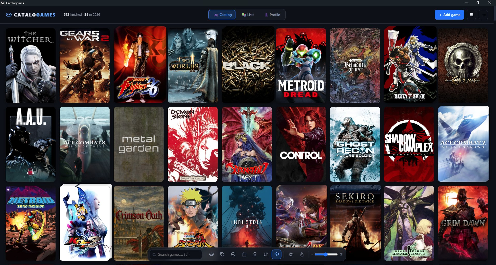
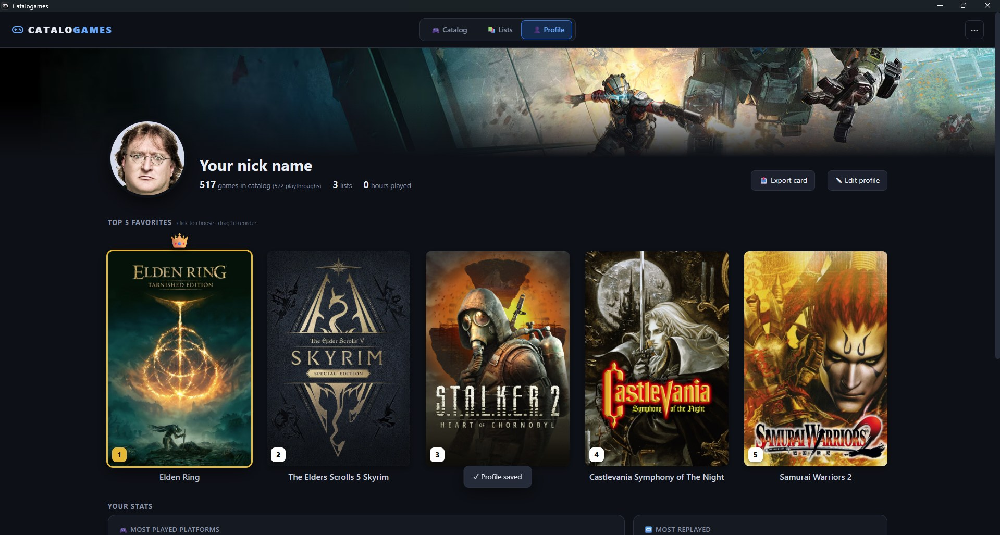
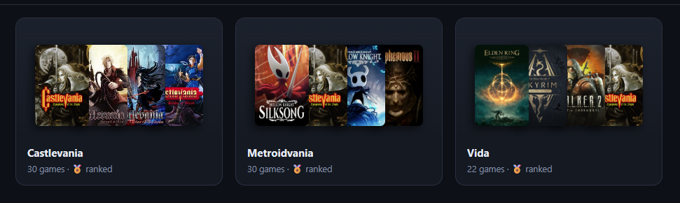

# 🎮 Catalogames

[🇺🇸 English](README.md) | **🇧🇷 Português**

*Catálogo de jogos com forma de backlog local.*

> [!NOTE]
> **Oi! Um aviso antes de tudo: este projeto é vibecodado.** 🤖
> Todo o código foi escrito com IA (Claude, da Anthropic), a partir das ideias, pedidos e testes de **[@leoblaidd](https://github.com/leoblaidd)**.
> Sei que muita gente não curte trabalho feito por IA, e tudo bem. Por isso o aviso vem logo aqui no começo, pra você decidir com calma se quer seguir. Se quiser, seja bem-vindo! 🎮

**Autor:** [@leoblaidd](https://github.com/leoblaidd)

O Catalogames é um app leve para Windows (instalador de ~1,4 MB, feito com Tauri) que organiza os jogos que você já zerou, jogou ou quer jogar. Ele funciona como uma estante de capas: você cadastra cada jogo com nota, plataforma e ano, e monta listas e rankings com eles. Tudo fica salvo numa pasta do seu PC, sem conta, sem nuvem e sem internet obrigatória.



---

## ✨ Funções

O app tem três abas no centro do topo: **🎮 Catálogo**, **📚 Listas** e **👤 Perfil**, com uma animação deslizando entre elas. O nome fica à esquerda, com os números da aba ao lado, e os botões da aba à direita, com as configurações sempre no canto.

### Catálogo
- Grade de capas com tamanho ajustável, agrupada pelo ano em que você terminou, pelo ano de lançamento ou sem agrupar.
- Para cada jogo: título, plataforma, status (**Terminado**, **Jogado** ou **Quero jogar**), ano em que terminou, ano de lançamento, horas jogadas, nota de 0 a 10 (com meio ponto), gêneros, favorito e um comentário ou review.
- Busca instantânea (atalho <kbd>/</kbd>) e filtros por plataforma, gênero, status, ano e nota.
- **Filtro de nota exato:** "Nota 5" mostra os jogos com 5 e 5,5, com os 5,5 primeiro.
- Ordenação por data, nota, nome, horas ou lançamento.
- **Dois jeitos de mostrar os filtros** (escolha nas Configurações):
  - **Barra no topo**, com os filtros escritos por extenso.
  - **Dock flutuante** embaixo, com a busca, um ícone pra cada filtro e o tamanho das capas. Cada ícone abre uma gaveta com as opções em quadradinhos.
- Botão para esconder a busca e os filtros (ou o dock) e deixar só as capas.
- **Jogou de novo?** Jogos com o mesmo título contam como o mesmo jogo jogado em anos diferentes:
  - Ao cadastrar, o app sugere o jogo e puxa nota, lançamento, gêneros e capa. Você só ajusta o ano.
  - Nota, lançamento, gêneros e capa ficam sempre iguais em todas as jogadas.
  - A tela do jogo mostra só "🔁 Você jogou isso X vezes" e os anos. Clicar num ano abre aquela jogada.
  - Se as jogadas ficarem com dados diferentes, aparece o botão **Igualar ao 1º registro**, que copia tudo da primeira jogada cadastrada.
  - Fora do agrupamento por ano terminado, as jogadas viram uma pilha: uma capa um pouco mais escura atrás. Passando o mouse, abre um leque com as 3 últimas jogadas e um selo **+N** quando tem mais. Clicar numa carta do leque abre aquela jogada.
- Gêneros em ordem alfabética, com busca: digite pra filtrar ou criar um novo. A lista é editável nas configurações.
- **Importar uma lista de jogos** de um arquivo `.txt` ou `.md`, um por linha: `Nome - ano que jogou - ano do jogo - plataforma - nota`. O que não estiver no padrão é pulado, e o app mostra uma prévia antes de importar. Os jogos importados aparecem com borda colorida até você completar capa, horas e gêneros.

- **Tela do jogo:** clique numa capa e abre um card centralizado com o banner do jogo no topo e a capa grande sobreposta. Sem banner, o app usa a própria capa desfocada. Depois de editar, você volta para essa tela.
- **Modo arte:** o botão ao lado do X abre a tela do jogo em tela cheia, com o banner ocupando tudo, a capa maior no canto inferior esquerdo, as infos ao lado e os botões à direita. O **Voltar** (ou Esc) retorna ao modo normal.

### Perfil



- Foto de perfil, nome e uma imagem de topo larga, que expande quando você rola para cima.
- Números: jogos catalogados, listas e horas jogadas.
- **Top 5 favoritos**, com coroa no 1º. Clique para escolher e arraste para reordenar.
- Painéis com plataformas mais jogadas, jogos terminados por ano, o mais rejogado, nota média e gênero favorito.
- Dá pra ajustar a posição da imagem do topo, arrastando ou pelo controle.

### Exportar imagens (PNG)
- **Card do perfil** (800 de largura, altura conforme o que você marcar): foto, um pouco da imagem do topo, nome, Top 5 lado a lado (o 1º com coroa e um pouco maior) e números como jogos do ano, jogos ao todo e plataforma mais jogada. Você desmarca o que não quiser antes de exportar.
- **Lista:** fundo preto, nome da lista na cor do tema, capas grandes em 3, 5 ou 10 colunas, com ou sem ranking e nomes.
- **Catálogo:** os jogos de um ano, de uma plataforma ou de um gênero (um filtro por vez), com nota e nomes opcionais.
- Sempre com prévia antes, e você escolhe onde salvar.

### Atualizações
- Em Configurações, o botão **Verificar atualização** procura uma versão nova nas Releases deste repositório. Ele baixa o instalador e abre sozinho. Também dá pra deixar ele verificar toda vez que o app abre.

### Listas e rankings



- Crie listas como "Top 10 RPGs" ou "Musous favoritos", com ou sem numeração. O top 3 aparece em ouro, prata e bronze.
- Cada lista abre em tela cheia, com busca, tamanho das capas ajustável e botões de editar e excluir.
- Arraste as capas para reordenar, tanto na lista aberta quanto no editor. Os números do ranking se ajustam na hora.
- Opção de esconder os nomes embaixo das capas.
- Ao digitar o nome de um jogo, o app sugere os jogos que você já catalogou e reaproveita a capa deles.
- **Lista a partir da busca:** pesquisou ou filtrou? Um botão cria uma lista com os jogos que estão aparecendo.
- **Seleção com Ctrl:** segure <kbd>Ctrl</kbd> e clique nas capas para marcar. <kbd>Ctrl</kbd>+<kbd>A</kbd> marca todas. Depois é só criar uma lista com as marcadas.

### Capas
- **SteamGridDB integrado:** digite o nome do jogo e clique em *Buscar capa no SteamGridDB*. Abre uma grade com as capas da comunidade, e um clique baixa a escolhida. Precisa de uma [chave gratuita da API](https://www.steamgriddb.com/profile/preferences/api), configurada uma única vez.
- **Banner do topo:** na edição do jogo tem um espaço para o banner largo, com busca nos **Heroes** do SteamGridDB, arquivo ou link.
- Também dá para colar uma imagem (<kbd>Ctrl</kbd>+<kbd>V</kbd>), arrastar um arquivo ou usar um link, inclusive o link da página do jogo na Steam.
- Ao cadastrar um jogo que já está em alguma lista, o app sugere ele e reaproveita a capa.
- As imagens grandes são reduzidas automaticamente para não pesar a pasta.

### Aparência
- **Barra de título integrada:** a barra de cima do app também é a barra da janela, com minimizar, maximizar e fechar à direita. Arraste pra mover a janela; clique duas vezes pra maximizar.
- **Ícones de contorno** em tudo (do [Lucide](https://lucide.dev)), botões com um leve relevo 3D e barra de cima mais clara, deixando o desfoque aparecer.
- **Capa como um card de verdade:** na tela do jogo (normal e modo arte), a capa inclina em 3D seguindo o mouse, com um reflexo de luz suave.
- **Três idiomas:** português, inglês e espanhol (🌐 **Idioma** nas Configurações, sem reiniciar). Na primeira vez o app abre no idioma do Windows; se não for nenhum dos três, abre em inglês.
- **Rolagem suave** com a roda do mouse no catálogo, nas listas e no perfil.
- **Efeitos sonoros** suaves e graves (trocar de aba, abrir e fechar, salvar, exportar, filtros), criados na hora pelo próprio app. Dá pra desligar nas Configurações.
- Tema **escuro**, **claro** ou **automático** (segue o Windows).
- Cor de destaque com 10 opções prontas ou qualquer cor personalizada.

---

## 💾 Onde ficam seus dados

Tudo fica dentro da pasta onde você instalou o app:

```
Catalogames\
├── Catalogames.exe
└── dados\
    ├── biblioteca.json   ← jogos e listas (texto legível)
    ├── config.json       ← tema, cor, preferências
    └── capas\            ← imagens das capas
```

- **Atualizar:** é só instalar a versão nova por cima, na mesma pasta. A pasta `dados` nunca é apagada.
- **Desinstalar:** o desinstalador pergunta se você quer apagar seus jogos. A resposta padrão é "Não".
- **Backup:** copie a pasta `dados`. Para levar para outro PC, instale lá e cole a pasta.

---

## 📥 Instalação

1. Baixe o instalador mais recente em **[Releases](../../releases)**.
2. Execute e escolha a pasta de instalação (por exemplo, `D:\Jogos\Catalogames`).
3. O Windows pode mostrar "O Windows protegeu o computador", porque o instalador não tem assinatura digital paga. Clique em **Mais informações → Executar assim mesmo**.

> O app usa o **WebView2** (o motor do Edge que já vem no Windows 11 e na maioria dos Windows 10). Se faltar, o instalador avisa e mostra onde baixar.

> Evite instalar em *Arquivos de Programas*: o Windows não deixa gravar ali, e aí os dados vão para `%APPDATA%\Catalogames\dados`.

---

## 🛠️ Rodando o código

Feito com [Tauri 2](https://tauri.app/) (Rust). A interface inteira está em um único arquivo HTML, sem frameworks, e usa o WebView2 do Windows em vez de levar um navegador junto.

```bash
cd src-tauri
cargo run                      # abre o app em modo desenvolvimento
../build/fazer-instalador.sh   # gera o instalador do Windows em dist/ (compila a partir do Linux)
```

O `fazer-instalador.sh` compila pra `x86_64-pc-windows-gnu` (precisa do `mingw-w64` e do `rust-src`) e usa o `makensis` pra montar o instalador.

| Arquivo | O que faz |
|---|---|
| `app/index.html` | A interface toda: catálogo, listas, perfil, modais, temas |
| `src-tauri/src/main.rs` | O app em Rust: janela, leitura e gravação em `dados\`, downloads de imagens, SteamGridDB, atualizações |
| `app/idiomas.js` | Traduções da interface: cada texto em português com a versão em inglês e espanhol |
| `src-tauri/src/ponte.js` | Ponte entre a interface e o Rust (cria o `window.catalogame`) |
| `src-tauri/tauri.conf.json` | Configuração do Tauri (nome, versão, ícone) |
| `build/instalador.nsi` | Script do instalador (NSIS). Instala por cima mantendo a pasta `dados` |
| `build/fazer-instalador.sh` | Compila o app e o instalador |

> Até a 1.7.1 o app era feito com Electron. Esse código continua no histórico do repositório.

---

## ☕ Apoie

O Catalogames é gratuito e vai continuar sendo. Se ele te ajudou e você quiser dar uma força, dá pra me pagar um café no **[Ko-fi](https://ko-fi.com/leoblaidd)**. 💜

[](https://ko-fi.com/leoblaidd)

---

## 📜 Versões

### 2.1.0
- A barra de cima virou também a barra da janela, com minimizar, maximizar e fechar.
- Emojis trocados por ícones de contorno (Lucide); engrenagem nas Configurações; funil nos filtros, escurecido quando estão ocultos.
- Jogos rejogados: uma capa mais escura atrás; no hover, leque com as 3 últimas jogadas e selo **+N**.
- Capa em 3D com reflexo de luz na tela do jogo; modo arte sem o box atrás das infos.
- Botões com leve relevo 3D, barra de cima mais clara, logo "CG" e ícone de agrupar do dock apagado em "Sem agrupar".

### 2.0.0
- **Três idiomas:** português, inglês e espanhol, com detecção do idioma do Windows e troca nas Configurações sem reiniciar.
- Instalador também em português, inglês e espanhol.

### 1.9.0
- **Modo arte:** tela cheia na tela do jogo, com o banner ocupando tudo, a capa maior e as infos num painel.
- **Efeitos sonoros** (com opção pra desligar nas Configurações).
- **Rolagem suave** no catálogo, nas listas e no perfil.

### 1.8.0
- **Agora em Tauri (Rust):** instalador de ~1,4 MB (antes ~110 MB) e app instalado com ~4 MB. Mesmas funções e mesmos dados.
- Filtros do catálogo também em **dock flutuante** embaixo, com ícones e gavetas de opções (escolha nas Configurações).
- Jogadas repetidas mais limpas na tela do jogo, com o botão **Igualar ao 1º registro** quando os dados divergem.
- Card do perfil com altura que acompanha o que foi marcado pra exportar.
- Título das imagens de catálogo e lista menor e em semibold.
- Capa da tela do jogo sem borda, só com uma sombra leve.

### 1.7.1
- Topo reorganizado: nome e números à esquerda, abas no centro, botões e configurações à direita.
- O X da tela do jogo voltou para o canto superior direito.
- Ao salvar ou cancelar a edição, você volta para a tela do jogo.
- Jogadas repetidas: o aviso também mostra quando a capa ou o banner estão diferentes, e o "igualar" inclui o banner.
- Ícone novo: preto e cinza escuro, com borda branca leve.

### 1.7.0
- Abas centralizadas no topo, com animação deslizante; botões à esquerda.
- Filtros do catálogo mais compactos, cabendo numa linha só em 1080p.
- Nova tela do jogo: centralizada, com banner no topo, capa maior e X no canto superior esquerdo.
- Banner do jogo na edição, com busca nos Heroes do SteamGridDB.
- Formulário de edição mais largo e organizado em seções.
- Card do perfil: Top 5 lado a lado, com o 1º maior e de coroa.

### 1.6.0
- Exportar PNG: card do perfil, listas e catálogo (por ano, plataforma ou gênero), com prévia.
- Verificar atualização direto pelas Releases do GitHub, com download e instalação.
- Ajuste da posição da imagem do topo do perfil.
- Capas do Top 5 maiores, acompanhando a largura da tela.
- Busca nos gêneros: digitar filtra os gêneros, e Enter marca ou cria.
- Saiu o aviso "role pra cima" da imagem do topo.

### 1.5.0
- Abas lado a lado: Catálogo, Listas e **Perfil**.
- Aba Perfil com foto, nome, imagem de topo, números, Top 5 favoritos e painéis de estatísticas.
- Importar lista de jogos por arquivo `.txt`/`.md`, com prévia. Os jogos ficam marcados "para completar".
- Filtro "Para completar".
- O selo de vezes jogadas saiu. A pilha de capas continua.

### 1.4.0
- Agrupar por ano de lançamento, além de ano terminado ou sem agrupar.
- Jogos repetidos (o mesmo jogo jogado em anos diferentes):
  - O cadastro sugere o jogo e puxa os dados para uma nova jogada.
  - As jogadas aparecem empilhadas quando você busca, filtra ou ordena.
  - A tela do jogo lista todas as jogadas.
  - Nota, lançamento, gêneros e capa ficam sincronizados entre elas.
- Gêneros em ordem alfabética.
- Adicionar e excluir gêneros nas configurações.

### 1.3.0
- As listas abrem em tela cheia, com voltar, busca, tamanho das capas e editar/excluir.
- Arrastar para reordenar com a lista aberta, com o ranking renumerando sozinho.
- Opção de esconder os nomes dos jogos embaixo das capas.
- Números do ranking do 4º em diante em branco com número preto.
- No cadastro, o app sugere jogos que já estão nas listas, com capa.
- Botões de tema alinhados nas configurações.

### 1.2.0
- O nome mudou para **Catalogames**. A atualização por cima da versão antiga mantém tudo.
- Busca de capas no **SteamGridDB** dentro do app, no catálogo e nas listas.
- Novo botão para ocultar ou mostrar a busca e os filtros.
- O tamanho das capas voltou para a barra de filtros.

### 1.1.0
- Filtro de nota exato (5 = 5 e 5,5), com os ,5 primeiro.
- Listas sugerem jogos do catálogo e reaproveitam a capa.
- Criar lista a partir da busca ou dos jogos marcados com Ctrl.
- Tema claro, escuro ou automático e cor de destaque personalizável.
- Janela de configurações.

### 1.0.0
- Primeira versão como app instalável: catálogo, listas ranqueadas, capas salvas localmente e importação da versão HTML antiga.

---

## 🙏 Créditos

- Ideia, direção e testes: **[@leoblaidd](https://github.com/leoblaidd)**
- Código: escrito com IA (Claude, da Anthropic)
- Capas da comunidade: [SteamGridDB](https://www.steamgriddb.com)
- Ícones: [Lucide](https://lucide.dev) (licença ISC)
